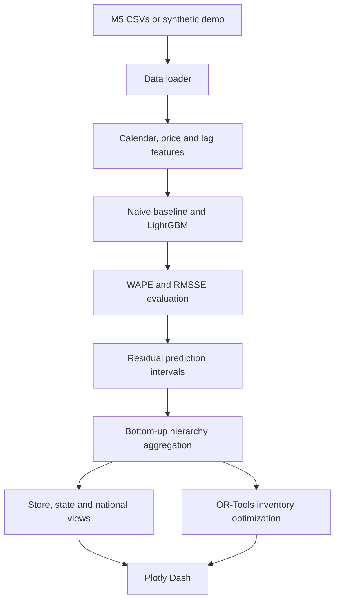

# Architecture

Historical item-store sales feed the feature and model pipeline. Validation forecasts are presented in the prototype dashboard. A production extension should generate recursive future covariates, save forecast runs, and include replenishment lead times.
